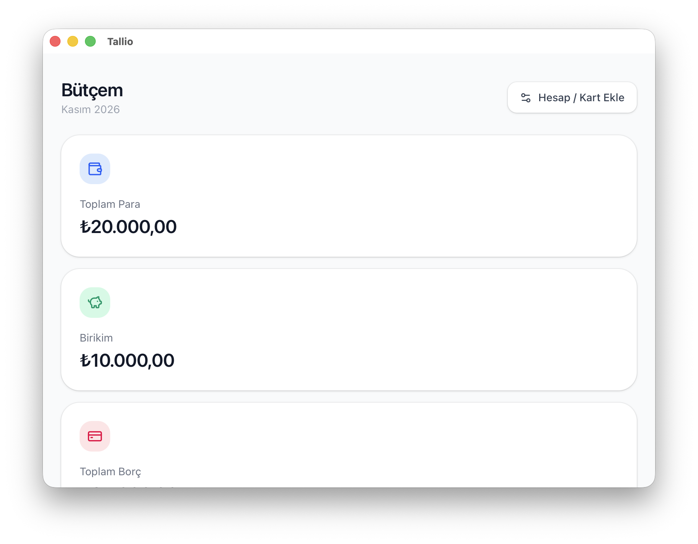
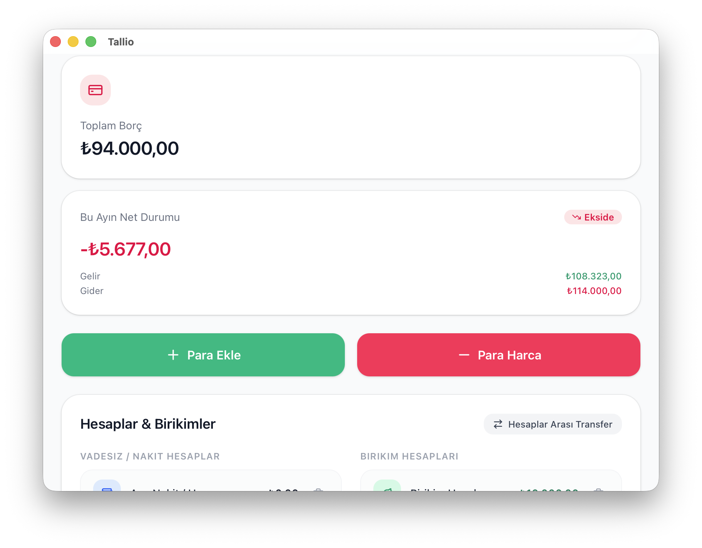
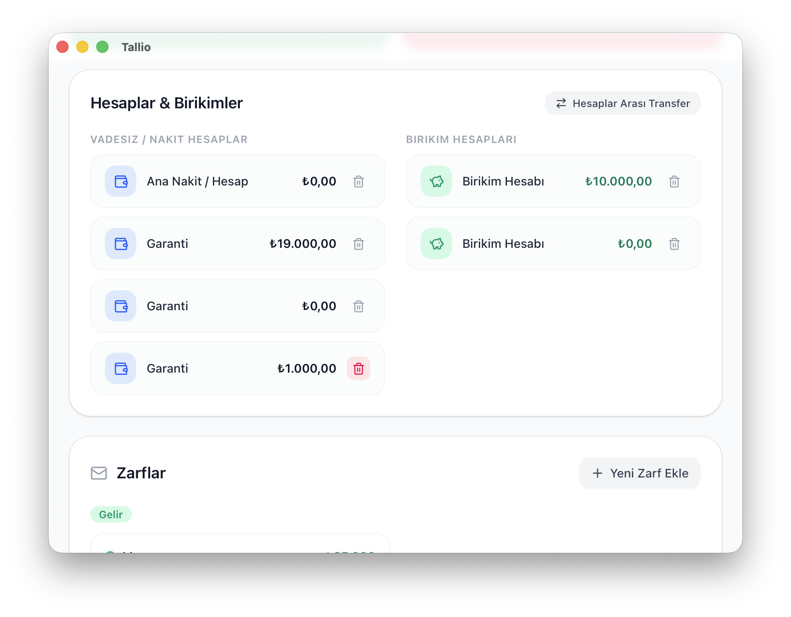
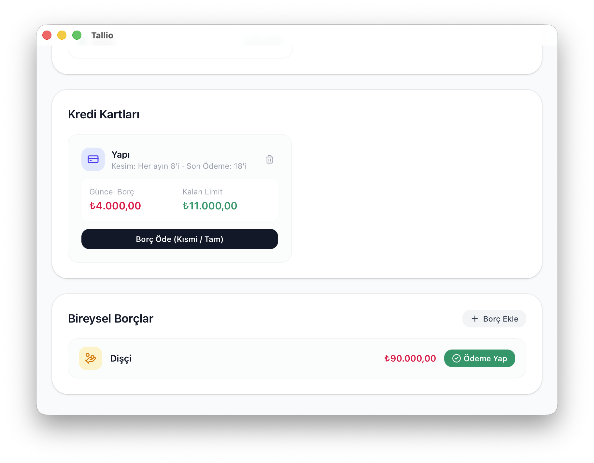

# Tallio

### Local-First Personal Finance & Envelope Budgeting App for macOS








---

## Overview

**Tallio** is a lightweight, privacy-first personal finance and envelope budgeting application built specifically for macOS.

Designed around a local-first philosophy, Tallio gives you complete control over your personal finances without relying on cloud services, external servers, or subscription-based platforms.

All financial records, transactions, accounts, budgets, and debt information are stored locally in an embedded SQLite database named `butce.db`.

### Core Philosophy

- **Zero Cloud** — No remote servers, cloud synchronization, or external financial services.
- **Zero Subscriptions** — No monthly fees, premium tiers, or recurring payments.
- **Zero Telemetry** — No analytics, tracking, or background data collection.
- **Complete Data Ownership** — Your financial information stays on your device.
- **Lightweight & Native** — Built with Tauri v2 for a fast, resource-efficient macOS experience.

Tallio is designed for people who want to manage their money independently, understand their spending habits, and maintain complete ownership of their financial data.


---

## Vibe Coding & Multi-AI Orchestration

Tallio was architected and developed from scratch using **Vibe Coding**, combining human direction, iterative problem-solving, and specialized AI-assisted engineering.

Rather than relying on a single AI model for the entire development process, Tallio was built using a token-efficient, multi-AI orchestration workflow. Each AI model was assigned a specialized engineering responsibility based on its strengths.

### Specialized AI Development Pipeline

| AI Model    | Role               | Contributions                                                                                                                                                                     |
| :---------- | :----------------- | :-------------------------------------------------------------------------------------------------------------------------------------------------------------------------------- |
| **Gemini**  | System Architect   | Overall architecture, six-table SQLite database schema, Tauri v2 capability and security configuration, build troubleshooting, and runtime debugging.                             |
| **ChatGPT** | Financial Engineer | Core financial engine (`financeEngine.ts`), installment month-difference calculations, overdraft protection, partial debt repayment logic, and financial calculation consistency. |
| **Claude**  | Frontend Engineer  | React component architecture, macOS-inspired interface, Tailwind CSS styling, interactive modals, visual progress indicators, and frontend refinements.                           |

### Development Workflow

1. **Architecture:** Establish the application structure, database relationships, and technical foundations.
2. **Engineering:** Implement the financial engine and business logic with particular attention to calculation accuracy.
3. **Design:** Build a clean, consistent, and intuitive user interface.
4. **Integration:** Connect the frontend, financial services, and SQLite persistence layer.
5. **Refinement:** Iteratively test, troubleshoot, and improve the application.

The objective was not simply to generate code with AI, but to orchestrate specialized AI capabilities into a cohesive software engineering workflow.

---

## Features

### 1. Executive Financial Dashboard

A centralized overview of your financial position, providing real-time visibility into your accounts and obligations.

**Financial indicators:**

- **Total Cash** — Combined balance across checking accounts.
- **Total Savings** — Combined balance across savings accounts.
- **Total Debt** — Outstanding credit card and personal loan obligations.
- **Monthly Net Status** — Monthly income versus expenses.
- **Surplus / Deficit Indicator** — A visual badge showing whether your monthly financial position is positive or negative.

The dashboard provides a quick understanding of your financial health without navigating through multiple screens.


### 2. Envelope Budgeting System

Tallio implements an envelope-based budgeting methodology that helps users allocate income into predefined spending categories.

**Key capabilities:**

- Create custom income and expense envelopes.
- Define monthly spending limits for individual expense categories.
- Track spending against allocated budgets.
- Visual progress bars showing budget utilization.
- Automatic warnings when spending reaches the **80% threshold**.
- Monitor remaining budget throughout the month.

The envelope system encourages intentional spending by giving every budget category a clear financial boundary.


### 3. Credit Card & Installment Automation

A dedicated system for managing credit cards, tracking outstanding balances, and monitoring installment-based purchases.

**Credit card management:**

- Track individual credit card limits.
- Monitor available credit.
- Record statement cutoff dates.
- Track payment due dates.
- Monitor outstanding card balances.

**Automatic installment calculations:**

Tallio supports multi-month installment purchases and automatically distributes their financial impact across future months.

For example, a purchase of 12,000 units split into six installments generates six monthly expense entries of 2,000 units.

These installments are automatically reflected in future monthly expense calculations and envelope statistics, helping users understand their upcoming financial commitments.


### 4. Multi-Account Management & Overdraft Protection

Manage multiple financial accounts independently while maintaining accurate balance tracking.

**Account management features:**

- Separate checking and savings accounts.
- Track balances for individual accounts.
- Transfer money between accounts.
- View account-specific financial activity.
- Confirmation dialogs before deleting accounts.
- Strict balance validation to prevent accounts from dropping below zero.

Tallio applies balance checks before transactions are committed, helping prevent accidental overdrafts and inconsistent account records.

### 5. Partial Debt Repayments

Debt management supports flexible repayment rather than requiring users to settle entire outstanding balances at once.

Users can:

- Make partial payments toward credit card balances.
- Pay custom amounts toward personal loans.
- Track remaining outstanding debt.
- Reflect repayments in the relevant financial balances.

### 6. Smart Reminders & Native macOS Notifications

Tallio helps users stay ahead of upcoming financial obligations through an integrated reminder system.

**Reminder capabilities:**

- Monitor upcoming credit card payment deadlines.
- Track personal loan repayment due dates.
- Identify obligations approaching within a five-day window.
- Display contextual in-app notification banners.
- Deliver native macOS desktop notifications.

The goal is to make important payment deadlines visible before they become missed payments.

### 7. Quick Transaction Management

A streamlined transaction interface makes recording income and expenses straightforward.

The transaction modal provides an accessible workflow for entering financial activity without unnecessary navigation.


---

## Tech Stack

Tallio combines modern web technologies with native desktop capabilities.

| Technology                                    | Purpose                                          |
| :-------------------------------------------- | :----------------------------------------------- |
| [Tauri v2](https://v2.tauri.app/)             | Lightweight desktop application framework        |
| [Rust](https://www.rust-lang.org/)            | Native backend and system integration            |
| [React](https://react.dev/)                   | Component-based frontend architecture            |
| [TypeScript](https://www.typescriptlang.org/) | Static typing and maintainable application logic |
| [Tailwind CSS v4](https://tailwindcss.com/)   | Utility-first interface styling                  |
| [Lucide React](https://lucide.dev/)           | Interface icons                                  |
| [SQLite](https://www.sqlite.org/)             | Embedded local relational database               |
| `@tauri-apps/plugin-sql`                      | SQLite database integration                      |
| `@tauri-apps/plugin-notification`             | Native desktop notifications                     |

### Application Architecture

Tallio follows a local-first desktop architecture.

```text
┌──────────────────────────────────────────────┐
│                  TALLIO APP                  │
│                                              │
│  ┌────────────────────────────────────────┐  │
│  │          React + TypeScript             │  │
│  │                                        │  │
│  │    Components / Pages / UI / Modals    │  │
│  └────────────────────┬───────────────────┘  │
│                       │                      │
│  ┌────────────────────▼───────────────────┐  │
│  │              Service Layer             │  │
│  │                                        │  │
│  │  financeEngine.ts                      │  │
│  │  Database Services                     │  │
│  │  Financial Calculations                │  │
│  └────────────────────┬───────────────────┘  │
│                       │                      │
│  ┌────────────────────▼───────────────────┐  │
│  │             Tauri v2 Backend            │  │
│  │                                        │  │
│  │  Rust / Native Plugins / Permissions   │  │
│  └────────────────────┬───────────────────┘  │
│                       │                      │
│  ┌────────────────────▼───────────────────┐  │
│  │              SQLite Database            │  │
│  │                                        │  │
│  │                butce.db                │  │
│  └────────────────────────────────────────┘  │
└──────────────────────────────────────────────┘
```

All financial persistence is handled locally through SQLite. The application does not require a remote backend or external database server.

---

## Project Structure

The project follows a modular structure that separates interface components, business logic, database services, type definitions, and native application configuration.

```text
tallio/
│
├── screenshots/
│   ├── dashboard.png
│   ├── envelopes.png
│   ├── cards-debts.png
│   └── transaction-modal.png
│
├── src/
│   ├── components/
│   │   ├── dashboard/
│   │   ├── accounts/
│   │   ├── envelopes/
│   │   ├── transactions/
│   │   ├── cards/
│   │   └── common/
│   │
│   ├── services/
│   │   ├── financeEngine.ts
│   │   ├── database.ts
│   │   └── ...
│   │
│   ├── types/
│   │   └── finance.ts
│   │
│   ├── App.tsx
│   ├── main.tsx
│   └── ...
│
├── src-tauri/
│   ├── capabilities/
│   ├── src/
│   ├── icons/
│   ├── Cargo.toml
│   ├── Cargo.lock
│   └── tauri.conf.json
│
├── .gitignore
├── package.json
├── package-lock.json
├── tsconfig.json
├── vite.config.ts
├── index.html
└── README.md
```

---

## Installation & Development

Tallio is currently designed specifically for macOS.

You can clone the repository, install its dependencies, and build the application locally.

### Prerequisites

Make sure the following tools are installed on your Mac:

| Requirement              | Description                               |
| :----------------------- | :---------------------------------------- |
| macOS                    | Supported Apple desktop operating system  |
| Xcode Command Line Tools | Required native development tools         |
| Node.js                  | JavaScript runtime and package management |
| Rust                     | Required for compiling the Tauri backend  |
| Git                      | Repository version control                |

### 1. Install Xcode Command Line Tools

Open Terminal and run:

```bash
xcode-select --install
```

### 2. Install Node.js

Download and install Node.js from [nodejs.org](https://nodejs.org/).

Verify the installation:

```bash
node -v
npm -v
```

### 3. Install Rust

Install Rust using the official installation tool:

```bash
curl --proto '=https' --tlsv1.2 -sSf https://sh.rustup.rs | sh
```

Restart your terminal or reload your shell configuration.

Verify the installation:

```bash
rustc --version
cargo --version
```

For additional setup information, refer to the [official Tauri prerequisites documentation](https://v2.tauri.app/start/prerequisites/).

### 4. Clone the Repository

```bash
git clone https://github.com/YOUR_USERNAME/tallio.git
cd tallio
```

### 5. Install Dependencies

```bash
npm install
```

### 6. Run in Development Mode

```bash
npm run tauri dev
```

This command starts the frontend development server and launches the native macOS application.

A fresh local SQLite database is initialized automatically if one does not already exist.

### 7. Build for Production

```bash
npm run tauri build
```

After a successful build, the macOS application bundle will be available at:

```text
src-tauri/target/release/bundle/macos/Tallio.app
```

You can open the generated application directly or move it into your macOS Applications folder.

### Important: Your Financial Data Is Never Included

Cloning the Tallio repository does **not** download or expose anyone's personal financial information.

- SQLite database files (`.db`) are excluded through `.gitignore`.
- No personal financial records are committed to the repository.
- A fresh local database initializes automatically on first launch.
- Every installation starts with its own independent financial database.

You can safely clone the repository without accessing another user's financial data.

---

## Data Storage & Privacy

Privacy is a fundamental architectural decision in Tallio, not an optional feature.

All financial information is stored in a local SQLite database using the Tauri SQL plugin.

### Database Location

The default database location on macOS is:

```text
~/Library/Application Support/com.fatih.butce/butce.db
```

This is the application's local data directory.

### Data Ownership

**Local Persistence**

All financial records are stored locally in `butce.db`. No remote database or cloud account is required.

**User-Controlled Backups**

Because the database is a local SQLite file, users can manually back up their financial information by copying `butce.db` to another secure location.

**Complete Local Reset**

Users can reset their application data by closing Tallio and removing the local database file. The application will initialize a fresh database on the next launch.

> **Backup recommendation:** Always close Tallio before manually copying, replacing, or deleting the database file to avoid interfering with active database operations.

### Privacy Commitments

| Principle          | Implementation                                         |
| :----------------- | :----------------------------------------------------- |
| Cloud Independence | No cloud database or remote financial storage          |
| Data Ownership     | Financial records remain on the user's Mac             |
| No Telemetry       | No built-in analytics or behavioral tracking           |
| No Subscription    | No recurring fees or premium subscription requirements |
| Local Database     | Embedded SQLite persistence                            |
| Manual Backups     | Direct access to the database file                     |

Tallio does not require users to trust an external financial platform with their personal information.

---

## Security Considerations

Although Tallio is designed as a local-first application, users should take appropriate precautions when managing sensitive financial information.

- Keep macOS and the application updated.
- Protect your Mac with a strong login password.
- Use FileVault or another appropriate disk-encryption solution.
- Store database backups in secure locations.
- Avoid sharing your `butce.db` file publicly.
- Review application permissions and Tauri capabilities when modifying the source code.

**Note:** Local storage provides data ownership, but it does not automatically encrypt the SQLite database independently.

---

## Roadmap

Potential areas for future development:

- [ ] Advanced financial analytics and spending reports.
- [ ] Monthly and yearly financial comparisons.
- [ ] Interactive expense visualization.
- [ ] CSV transaction import and export.
- [ ] Automated database backup and restore.
- [ ] Customizable budget categories.
- [ ] Enhanced recurring transaction management.
- [ ] Improved financial forecasting.
- [ ] Additional native macOS integrations.

---

## Contributing

Contributions, bug reports, and suggestions are welcome.

If you would like to contribute:

1. Fork the repository.
2. Create a feature branch.
3. Implement your changes.
4. Test the application locally.
5. Submit a pull request describing your changes.

For significant changes, consider opening an issue first to discuss the proposed implementation.

Please keep contributions consistent with Tallio's core philosophy:

- Local-first architecture.
- Privacy-focused design.
- No unnecessary external dependencies.
- Maintainable and modular code.
- Accurate financial calculations.
- Clean and intuitive user experience.

---

## License

Tallio is distributed under the **MIT License**.

You are free to use, copy, modify, merge, publish, distribute, sublicense, and sell copies of the software, subject to the conditions of the MIT License.

See the [LICENSE](LICENSE) file for the complete license text.

---

## Acknowledgements

Tallio was developed through a combination of human direction, open-source technologies, and AI-assisted software engineering.

Special thanks to the teams and communities behind:

- [Tauri](https://tauri.app/)
- [React](https://react.dev/)
- [TypeScript](https://www.typescriptlang.org/)
- [Tailwind CSS](https://tailwindcss.com/)
- [SQLite](https://www.sqlite.org/)
- [Lucide](https://lucide.dev/)
- [Google Gemini](https://gemini.google.com/)
- [OpenAI ChatGPT](https://chatgpt.com/)
- [Anthropic Claude](https://claude.ai/)

---

\<p align="center">   \<strong>Tallio\</strong>   \<br />   Your finances. Your data. Your control.   \<br />   \<sub>Built for macOS. Designed for financial independence.\</sub> \</p>
